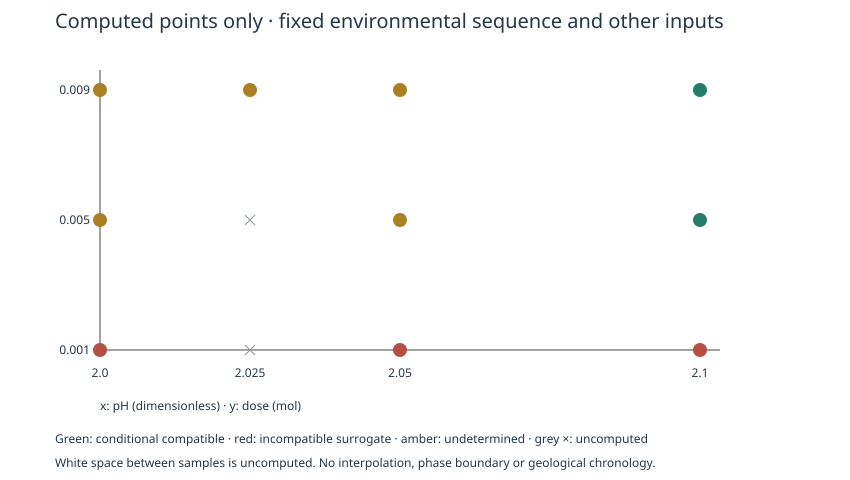

<h1 align="center">MineralTrace.jl</h1>

<p align="center">
  <strong>Explore mineral-forming mechanisms. Keep the evidence in view.</strong><br>
  Reproducible, auditable mineral–fluid mechanism screening powered by PHREEQC.
</p>

<p align="center">
  <a href="Project.toml"></a>
  <a href="https://julialang.org/downloads/"></a>
  <a href="https://www.usgs.gov/software/phreeqc-version-3"></a>
  <a href="examples/discovery.toml"></a>
  <a href="#scientific-status"></a>
  <a href="LICENSE"></a>
</p>

<p align="center">
  <strong>English</strong> · <a href="README.zh-CN.md">简体中文</a>
</p>

<p align="center">
  <a href="#overview">Overview</a> · <a href="#quickstart">Quickstart</a> · <a href="#workflows">Workflows</a> · <a href="#scientific-status">Scientific status</a> · <a href="#documentation">Documentation</a>
</p>

> [!NOTE]
> **Research preview.** MineralTrace compares conditional equilibrium-reaction mechanisms. Actual crystallization order remains undetermined. Independent calcite endpoint comparisons expose model discrepancies; a scientifically validated general process model is not yet established.

**v0.8.1 · Independent-source experiment; holdout qualification pending.** A second laboratory's five frozen 25 °C endpoints give **−1.25% to −10.40%** errors under the unchanged model, unlike REFLECT's positive bias in a different pressure/temperature domain. Database-calibration independence remains unknown; no model or strict path is certified. [Run and review](docs/INDEPENDENT_EXPERIMENT.md) · [Scientific comparison](data/validation/v081/REPORT.md) · [Model validation framework](docs/SCIENTIFIC_VALIDATION.md).

## Overview

**Which fluid changes could produce mineral reactions consistent with the evidence—and which possibilities remain unresolved?**

MineralTrace helps mineralogists and aqueous geochemists investigate that question in a bounded **Fluorite–Calcite** system. Supply a fluid recipe, parameter ranges, allowed processes and sourced event relationships. It generates environmental paths, executes real PHREEQC reactions, checks conservation and retains compatible, incompatible and undetermined model outcomes.

```text
Fluid + ranges + evidence → Candidate mechanisms → PHREEQC reactions → Conservation + evidence checks → Offline report
```

- **Explore mechanisms:** enumerate cooling, acidification, alkalinization and equilibrium combinations within explicit bounds.
- **Keep chemistry explicit:** finite mineral stocks, stoichiometric additions and full aqueous/solid accounting; all declared phases stay accessible throughout discovery.
- **Expose uncertainty:** retain multiple explanations, test detection thresholds and local parameters, and mark uncomputed combinations.
- **Audit every result:** export raw engine files, state dumps, database/source snapshots, CSV/JSON and reproduction scripts.

### A result you can inspect

<p align="center">
  
</p>

**Actual calculation, synthetic study.** This slice fixes the environmental sequence and all other inputs. Dots are calculated points; grey crosses and the space between samples are uncomputed. Colors classify an equilibrium-reaction surrogate, not observed mineral chronology. [Figure provenance](docs/assets/readme/README.md) · [Sensitivity workflow](docs/ROBUSTNESS.md).

## Quickstart

**Prerequisites:** Git, [Julia 1.10+](https://julialang.org/downloads/), and the [PHREEQC 3 CLI with its database](https://www.usgs.gov/software/phreeqc-version-3). The Julia package uses only standard libraries; install PHREEQC separately.

```sh
git clone https://github.com/Nerolithos/PHREEQC-MineralTrace.git
cd PHREEQC-MineralTrace

# Replace both paths with your installed files.
export PHREEQC_EXECUTABLE=/absolute/path/to/phreeqc
export PHREEQC_DATABASE=/absolute/path/to/phreeqc.dat

julia --project=. scripts/discover.jl examples/discovery.toml results
```

Open the printed `Report: …/report.html` in your browser. The report embeds its plots and works offline; no web server is required. Missing dependencies and failed calculations are reported explicitly.

The supplied **SYNTHETIC / SIMULATED** study computes 210 distinct chemical candidates. The reference run gives **2 conditionally compatible, 201 incompatible and 7 undetermined** surrogate outcomes. Two different staged NaOH additions remain compatible; narrowing the initial-pH range removes them. Counts depend on the search grammar and grid—they are not probabilities.

<details>
<summary>Windows configuration and tested environment</summary>

After entering the cloned repository, set paths in PowerShell:

```powershell
$env:PHREEQC_EXECUTABLE = 'C:\path\to\phreeqc.exe'
$env:PHREEQC_DATABASE = 'C:\path\to\phreeqc.dat'
julia --project=. scripts/discover.jl examples/discovery.toml results
```

Tested locally: Julia 1.10.10, macOS ARM64, PHREEQC 3.8.6-17100. Windows has not been verified by this project. See the [engine build reference, in Chinese](docs/REFERENCE.md#安装依赖) for the tested source-build procedure.

</details>

## Workflows

| Research task | Entry point | Guide |
| --- | --- | --- |
| Generate and screen environmental mechanisms | `scripts/discover.jl` | [Discovery](docs/DISCOVERY.md) |
| Check threshold and local parameter robustness | `scripts/robustness.jl` | [Robustness](docs/ROBUSTNESS.md) |
| Challenge the model with independent calcite endpoints | `scripts/validate_calcite_endpoint.jl` | [Experimental comparison](docs/CALCITE_ENDPOINT.md) |
| Compare explicitly specified reaction paths | `scripts/paths.jl` | [Path example](examples/reactive_paths.toml) |
| Simulate acid/base additions or scan SI constraints | `scripts/titrate.jl` / `scripts/mineraltrace.jl` | [Detailed reference](docs/REFERENCE.md) |

Run the robustness study or the frozen experimental comparison from the repository root:

```sh
julia --project=. scripts/robustness.jl examples/discovery.toml examples/robustness.toml results
julia --project=. scripts/validate_calcite_endpoint.jl results
julia --project=. scripts/attribute_calcite_bias.jl results
julia --project=. scripts/validate_scientific_models.jl results
julia --project=. scripts/validate_holdout.jl results
julia --project=. scripts/validate_upstream.jl results
```

The robustness command starts with discovery, adds one-at-a-time calculations and writes `robustness.html`. Reclassifying detection thresholds reuses verified chemical states; it does not overwrite pH or rerun a different reaction.

### Bring your own study

```sh
cp examples/discovery.toml my_discovery.toml
julia --project=. scripts/discover.jl my_discovery.toml results
```

Edit the complete template with your fluid totals (**mol/kgw**), initial conditions, mineral inventories (**mol**), allowed processes, sampling grids and evidence sources. Reagent doses are incremental **mol**, not concentration or titrant volume. Keep observations and assumptions distinct; leave missing measurements missing. Discovery fixes phase accessibility and does not accept a hand-ordered mineral activation sequence. [Input rules and limits](docs/DISCOVERY.md).

## Scientific status

**Saturation opportunity → modeled equilibrium reaction → independent observation** are separate evidence levels. Positive saturation index is not a nucleation event; the first significant solid increment is a declared screening surrogate, not a formation time.

| Outcome | Interpretation |
| --- | --- |
| `compatible` | Meets the specified model, reaction-surrogate and evidence conditions; conditional compatibility only |
| `incompatible` | Violates a hard constraint or the required surrogate behavior within this finite model test |
| `undetermined` | Available sources, reactions, chronology resolution or model applicability do not support a decision |

Actual formation order stays `undetermined` for every discovery candidate. A failed search does not exclude unsampled mechanisms; a successful search does not identify a unique history.

| Validation track | Current evidence |
| --- | --- |
| Engine consistency | Direct PHREEQC CLI comparisons and byte-identical exported-source reproductions |
| Chemical accounting | Element, net-charge and phase-direction checks; numerical closure is a hard gate |
| Independent experiment | Five digitized 24 °C calcite endpoints: predictions overestimate by approximately **15–29% per kg water** or **13–25% per kg final solution**; both unresolved mass bases are retained |

The experimental comparison is a bounded equilibrium-endpoint challenge. Per-point metadata remain incomplete; pH, kinetic rates, net mineral weight changes and a complete time path are not validated. The separate pure-water/regulated-CO₂ endpoint interface does not add gas exchange to discovery. [Experimental evidence and limitations](data/validation/EXPERIMENTAL_CASE_V070.md).

Discovery currently covers simplified Ca–F–C–O–H/Na/Cl chemistry, Calcite/Fluorite, **1 atm** and a **25–80 °C exploratory range**. Non-reference temperatures require explicit opt-in. It excludes gas exchange, mixing, carrier-water dilution, heat balance and kinetics. Species/activity completeness remains unverified; strict mode does not certify the model. Charge thresholds are configurable diagnostics, not universal water-quality standards; no ion concentrations are silently corrected. The teaching example's 5% policy is explicitly hypothetical. [Charge semantics](data/validation/CHARGE_BALANCE_SEMANTICS.md).

## Reproducibility

Keep the **entire output folder**: standalone HTML is convenient to read; raw inputs, state dumps, source/database snapshots and hashes support auditing. `steps.csv` and `balances.csv` expose chemistry; `analysis.json` stores deterministic results, while `results.json` retains runtime provenance.

Inside an exported discovery folder:

```sh
PHREEQC_EXECUTABLE=/absolute/path/to/phreeqc julia --project=. reproduce.jl
```

Robustness exports also provide `reproduce_robustness.jl`. The executable must still be supplied; compare recorded engine versions and hashes before interpreting differences.

<details>
<summary>Run software checks and understand the historical benchmark</summary>

```sh
julia --project=. test/runtests.jl
MINERALTRACE_INTEGRATION=1 julia --project=. test/runtests.jl
```

The integration run needs the configured engine/database. The recorded v0.7.0 local suite passed 1675 checks; this is engineering evidence, not a CI badge or experimental-accuracy certificate. [Execution record](data/validation/V070_STATUS.md). [v0.8.0 checks and independent replay](data/validation/V080_STATUS.md) cover the new profiles, candidate annotations and official benchmarks. The v0.7.1 suite passed 1685 local checks; the 35 attribution endpoints and exported replay are recorded [separately](data/validation/v071/VERIFICATION.json).

Historical Example 1 differences are attributed through controlled official database snapshots. The original modern-database-versus-historical-table benchmark still reports three differences at the unchanged tolerance; matched historical reproduction and modern regression are separate. [Attribution](data/validation/EXAMPLE1_ATTRIBUTION_V070.md).

</details>

## Julia API

```julia
using MineralTrace

study = load_discovery("examples/discovery.toml")
generated = generate_candidates(study)  # Enumerate without PHREEQC.
result = discover_paths(study, PHREEQCConfig(); root="results")
report_path = report(result)
```

Use the cloned project environment (`julia --project=.`). This README does not assume General registration or availability through `Pkg.add("MineralTrace")`.

## Documentation

[Model validation and applicability](docs/SCIENTIFIC_VALIDATION.md) covers profile matching, the evidence registry, audits and scientific limitations.

The two READMEs cover the same starting workflow; most detailed guides are in Chinese; the scientific-validation guide is in English.

[Discovery](docs/DISCOVERY.md) · [Robustness](docs/ROBUSTNESS.md) · [Calcite endpoints](docs/CALCITE_ENDPOINT.md) · [Full reference](docs/REFERENCE.md) · [v0.7.0 results](data/validation/V070_STATUS.md) · [Release readiness](docs/RELEASING.md)

## Contributing and research use

[Report a bug or propose an improvement](https://github.com/Nerolithos/PHREEQC-MineralTrace/issues). Reproducible TOML examples and independently documented experiments are particularly useful. Include units, fluid and gas boundaries, engine/database versions, measurement sources and reported uncertainties; preserve gaps rather than supplying typical values.

When sharing research results, record the repository commit, study configuration, PHREEQC version/database hash and original experimental or observational sources. [PHREEQC documentation](https://water.usgs.gov/water-resources/software/PHREEQC/documentation/phreeqc3-html/phreeqc3.htm) provides the underlying engine reference.

## License

Project code is [MIT licensed](LICENSE). PHREEQC, thermodynamic databases and literature retain their respective terms; source records are in [data/sources](data/sources). External experimental material is not relicensed by the project's MIT license.

<!-- Maintainers: update both READMEs on every significant version change, including source-version badges, value proposition, commands, figure provenance and scientific status. Badges describe verified facts; do not add CI/coverage/release/DOI claims without the corresponding infrastructure or record. -->
