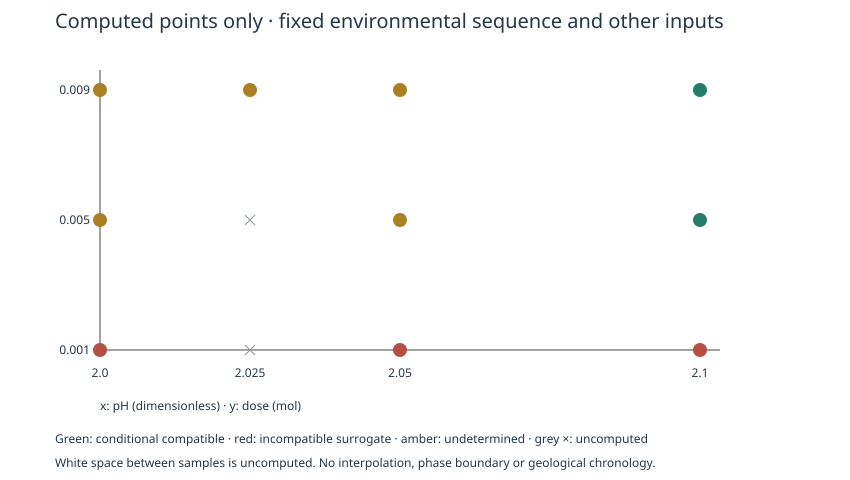

<h1 align="center">MineralTrace.jl</h1>

<p align="center">
  <strong>探索矿物形成机制，让每个结论都有证据可查。</strong><br>
  基于 PHREEQC 的可复现、可审计矿物–流体机制筛选工具。
</p>

<p align="center">
  <a href="Project.toml"></a>
  <a href="https://julialang.org/downloads/"></a>
  <a href="https://www.usgs.gov/software/phreeqc-version-3"></a>
  <a href="examples/discovery.toml"></a>
  <a href="#科学状态"></a>
  <a href="LICENSE"></a>
</p>

<p align="center">
  <a href="README.md">English</a> · <strong>简体中文</strong>
</p>

<p align="center">
  <a href="#概览">概览</a> · <a href="#快速开始">快速开始</a> · <a href="#研究流程">研究流程</a> · <a href="#科学状态">科学状态</a> · <a href="#文档导航">文档导航</a>
</p>

> [!NOTE]
> **研究预览阶段。** MineralTrace 比较条件性的平衡反应机制，真实结晶先后仍为无法判断。独立方解石终点对照已暴露模型偏差，尚未建立经过科学验证的通用过程模型。


**v0.8.2 · 跨实验偏差审计 + 本地研究工作台。** 两组冻结实验在不同条件下出现相反残差方向，没有直接匹配实验点对；不据此归因于压力或授予验证资格。新增 React/TypeScript 界面，可编辑研究条件、运行真实 PHREEQC、筛选候选并导出复现归档。[科学比较](data/validation/v082/REPORT.md) · [本地界面使用指南](docs/WORKBENCH.md)。

一次配置好 Julia/PHREEQC 后，在仓库目录构建并启动：

```sh
npm ci --prefix workbench
npm run build --prefix workbench
python3 scripts/workbench_server.py
```

打开 `http://127.0.0.1:8765`。需要 Python 3.11+；前端构建需要 Node.js/npm。引擎路径沿用下方环境配置，Julia 不在 PATH 时设置 `MINERALTRACE_JULIA`。仅本地运行，无账号或云服务；macOS 已实测，其他平台未认证。

**v0.8.1 · 第二组独立来源实验，严格留出资格待确认。** 对另一实验室五个冻结的 25 °C 终点使用原模型预测，偏差为 **−1.25% 至 −10.40%**，没有复现不同温压域 REFLECT 的正向偏差。与数据库参数校准的完整独立性仍未知，没有授予模型或严格路径验证资格。[运行与复核](docs/INDEPENDENT_EXPERIMENT.md) · [科学比较](data/validation/v081/REPORT.md) · [模型验证框架](docs/SCIENTIFIC_VALIDATION.md)。

## 概览

**哪些流体变化能够产生与证据相容的矿物反应？哪些可能性仍然无法判断？**

MineralTrace 帮助矿物学与水溶液地球化学研究者，在有界的 **Fluorite–Calcite（萤石–方解石）** 体系中探索这个问题。提供流体配方、参数范围、允许过程和有来源的事件关系，程序就会生成环境路径，执行真实 PHREEQC 反应，核对守恒，并保留相容、不相容和无法判断的模型结果。

```text
流体 + 范围 + 证据 → 候选机制 → PHREEQC 反应 → 守恒与证据检查 → 离线研究报告
```

- **探索候选机制：** 在明确范围内枚举冷却、酸化、碱化与平衡操作组合。
- **明确化学过程：** 使用有限固相库存、化学计量添加和水相／固相联合记账；发现过程中所有声明相始终可接触。
- **展示不确定性：** 保留多解，检查检测阈值和局部参数影响，明确标出未计算组合。
- **逐步审计结果：** 导出原始引擎文件、状态快照、数据库／源码快照、CSV／JSON 和复现脚本。

### 可以核查的结果预览

<p align="center">
  
</p>

**真实计算，合成研究案例。** 这张切片固定了环境序列和其他全部输入。圆点为实算结果；灰色叉号及点间空间均未计算。颜色对应平衡反应代理分类，不是观测到的矿物形成顺序。[图示来源](docs/assets/readme/README.md) · [敏感性流程](docs/ROBUSTNESS.md)。

## 快速开始

**需要：** Git、[Julia 1.10+](https://julialang.org/downloads/)，以及 [PHREEQC 3 CLI 和配套数据库](https://www.usgs.gov/software/phreeqc-version-3)。Julia 部分仅依赖标准库，PHREEQC 需要单独安装。

```sh
git clone https://github.com/Nerolithos/PHREEQC-MineralTrace.git
cd PHREEQC-MineralTrace

# 替换为本机已安装文件的实际路径。
export PHREEQC_EXECUTABLE=/absolute/path/to/phreeqc
export PHREEQC_DATABASE=/absolute/path/to/phreeqc.dat

julia --project=. scripts/discover.jl examples/discovery.toml results
```

用浏览器打开终端打印的 `Report: …/report.html`。报告内嵌图表，可以离线阅读，无需 Web 服务器。依赖缺失与计算失败会明确报告。

附带的 **SYNTHETIC / SIMULATED** 教学案例计算 210 个不同化学候选。参考运行给出 **2 条条件相容、201 条不相容、7 条无法判断** 的代理结果。两种分步 NaOH 添加方案都保留下来；收窄初始 pH 范围后，相容候选消失。数量取决于过程语法和采样网格，不能解释为概率。

<details>
<summary>Windows 配置与已测试环境</summary>

进入克隆的仓库后，在 PowerShell 中设置：

```powershell
$env:PHREEQC_EXECUTABLE = 'C:\path\to\phreeqc.exe'
$env:PHREEQC_DATABASE = 'C:\path\to\phreeqc.dat'
julia --project=. scripts/discover.jl examples/discovery.toml results
```

本地已测试 Julia 1.10.10、macOS ARM64、PHREEQC 3.8.6-17100；Windows 尚未在本项目验证。从源码构建引擎可参考[安装说明](docs/REFERENCE.md#安装依赖)。

</details>

## 研究流程

| 研究任务 | 入口 | 指南 |
| --- | --- | --- |
| 自动生成和筛选环境机制 | `scripts/discover.jl` | [候选发现](docs/DISCOVERY.md) |
| 检查阈值与局部参数稳健性 | `scripts/robustness.jl` | [稳健性分析](docs/ROBUSTNESS.md) |
| 用独立方解石终点挑战模型 | `scripts/validate_calcite_endpoint.jl` | [实验对照](docs/CALCITE_ENDPOINT.md) |
| 比较显式指定的反应路径 | `scripts/paths.jl` | [路径示例](examples/reactive_paths.toml) |
| 模拟酸碱添加或扫描 SI 约束 | `scripts/titrate.jl` / `scripts/mineraltrace.jl` | [详细参考](docs/REFERENCE.md) |

在仓库根目录运行稳健性研究或冻结的实验对照：

```sh
julia --project=. scripts/robustness.jl examples/discovery.toml examples/robustness.toml results
julia --project=. scripts/validate_calcite_endpoint.jl results
julia --project=. scripts/attribute_calcite_bias.jl results
julia --project=. scripts/validate_scientific_models.jl results
julia --project=. scripts/validate_holdout.jl results
julia --project=. scripts/validate_upstream.jl results
```

稳健性命令会从发现计算开始，增加单参数计算并输出 `robustness.html`。检测阈值复评使用已经核查的化学状态，不会覆盖 pH 或重算成另一种反应。

### 使用自己的研究数据

```sh
cp examples/discovery.toml my_discovery.toml
julia --project=. scripts/discover.jl my_discovery.toml results
```

修改完整模板中的流体总浓度（**mol/kgw**）、初始条件、固相库存（**mol**）、允许过程、采样网格与证据来源。药剂剂量是每步的增量 **mol**，不是浓度或滴定液体积。区分观测与假设，缺失测量保持缺失。发现接口固定相可接触性，不接收人为排列的矿物激活顺序。[输入规则与边界](docs/DISCOVERY.md)。

## 科学状态

**饱和机会 → 模型平衡反应 → 独立观察** 是三个不同证据层级。SI 过饱和不是成核事件；首次显著固相增量是声明的筛选代理，不是形成时间。

| 结果 | 解释 |
| --- | --- |
| `compatible` | 在指定模型、反应代理及证据条件下相容，仅为条件性结论 |
| `incompatible` | 在当前有限模型检验中违反硬约束或所需代理行为 |
| `undetermined` | 来源、反应、顺序分辨率或模型适用性不足以支持判断 |

每个发现候选的真实形成顺序始终为 `undetermined`。搜索未找到相容项不能排除未采样机制；找到相容项也不能认定唯一历史。

| 验证层级 | 当前证据 |
| --- | --- |
| 引擎一致性 | 直接 PHREEQC CLI 对照及归档源码的字节一致复现 |
| 化学记账 | 检查元素、净电荷和相方向；数值守恒是硬约束 |
| 独立实验 | 五个图示提取的 24 °C 方解石终点：按 kg 水归一化，模型高估约 **15–29%**；按 kg 最终溶液归一化，高估约 **13–25%**；保留尚未确定的两种质量基准 |

这是一项有边界的平衡终点挑战。每点元数据仍不完整，实测 pH、反应速率、矿物净重量变化和完整时间路径均未获验证。独立的纯水／受控 CO₂ 终点接口，不向发现语法加入气体交换。[实验证据与限制](data/validation/EXPERIMENTAL_CASE_V070.md)。

发现模型目前限于简化 Ca–F–C–O–H／Na／Cl 化学、Calcite／Fluorite、**1 atm** 和 **25–80 °C 探索范围**。非参考温度必须显式接受未验证条件；不包含气体交换、混合、载体水稀释、热量平衡或动力学。物种／活度模型完整性仍未验证，strict 模式不认证模型。电荷阈值是可配置诊断策略，不是通用水质标准；软件不静默修正离子浓度。教学案例的 5% 策略明确用于假设流体。[电荷语义](data/validation/CHARGE_BALANCE_SEMANTICS.md)。

## 复现与审计

保留**整个输出文件夹**：独立 HTML 用于阅读，原始输入、状态快照、源码／数据库快照和摘要用于审计。`steps.csv`、`balances.csv` 展示化学过程；`analysis.json` 保存确定性结果，`results.json` 另保留运行溯源。

进入导出的发现文件夹后运行：

```sh
PHREEQC_EXECUTABLE=/absolute/path/to/phreeqc julia --project=. reproduce.jl
```

稳健性归档另提供 `reproduce_robustness.jl`。引擎可执行文件仍需自行提供；解释差异前请核对记录的版本与摘要。

<details>
<summary>运行软件检查与理解历史基准</summary>

```sh
julia --project=. test/runtests.jl
MINERALTRACE_INTEGRATION=1 julia --project=. test/runtests.jl
```

集成测试需要已配置的引擎／数据库。v0.7.0 记录的本地完整测试为 1675 项通过，这是工程证据，不是 CI 徽章或实验准确度认证。[执行记录](data/validation/V070_STATUS.md)。[v0.8.0 检查与独立复现](data/validation/V080_STATUS.md)覆盖新档案、候选注释与官方基准。v0.7.1 本地完整测试 1685 项通过；35 个归因终点和导出包复现见[独立检查记录](data/validation/v071/VERIFICATION.json)。

历史 Example 1 已通过官方数据库快照完成受控归因。原始“现代数据库对历史表格”基准仍在不变容差下报告三项差异；匹配的历史复现与现代回归分别检查。[详细归因](data/validation/EXAMPLE1_ATTRIBUTION_V070.md)。

</details>

## Julia API

```julia
using MineralTrace

study = load_discovery("examples/discovery.toml")
generated = generate_candidates(study)  # 只枚举，不调用 PHREEQC。
result = discover_paths(study, PHREEQCConfig(); root="results")
report_path = report(result)
```

在克隆的项目环境中使用（`julia --project=.`）。本 README 不假设已经注册到 General，也不承诺 `Pkg.add("MineralTrace")` 可用。

## 文档

[科学验证与适用性说明](docs/SCIENTIFIC_VALIDATION.md)提供模型档案、证据登记、适用性匹配、审计与科学限制。导航

中英文首页覆盖相同的起步流程；多数详细指南以中文提供，科学验证指南为英文。

[候选发现](docs/DISCOVERY.md) · [稳健性](docs/ROBUSTNESS.md) · [方解石终点](docs/CALCITE_ENDPOINT.md) · [完整参考](docs/REFERENCE.md) · [v0.7.0 结果](data/validation/V070_STATUS.md) · [发布准备](docs/RELEASING.md)

## 参与贡献与科研使用

欢迎[提交问题或改进建议](https://github.com/Nerolithos/PHREEQC-MineralTrace/issues)。可复现的 TOML 示例与独立实验资料尤其有帮助。请附单位、流体与气体边界、引擎／数据库版本、测量来源和已报告的不确定度；不要用典型值填补资料缺口。

分享研究结果时，请记录仓库提交、研究配置、PHREEQC 版本／数据库摘要及原始实验或观察来源。底层引擎资料见 [PHREEQC 手册](https://water.usgs.gov/water-resources/software/PHREEQC/documentation/phreeqc3-html/phreeqc3.htm)。

## 许可证

项目代码使用 [MIT 许可证](LICENSE)。PHREEQC、热力学数据库和原始文献保留各自条款，来源登记见 [data/sources](data/sources)。项目 MIT 许可不覆盖外部实验资料。

<!-- 维护约定：每次显著版本更新同步修改两种语言的 README，包括源码版本徽章、项目价值、命令、图示来源和科学状态。徽章只展示可核查事实；没有对应基础设施或记录时，不添加 CI、覆盖率、Release 或 DOI 声明。 -->
