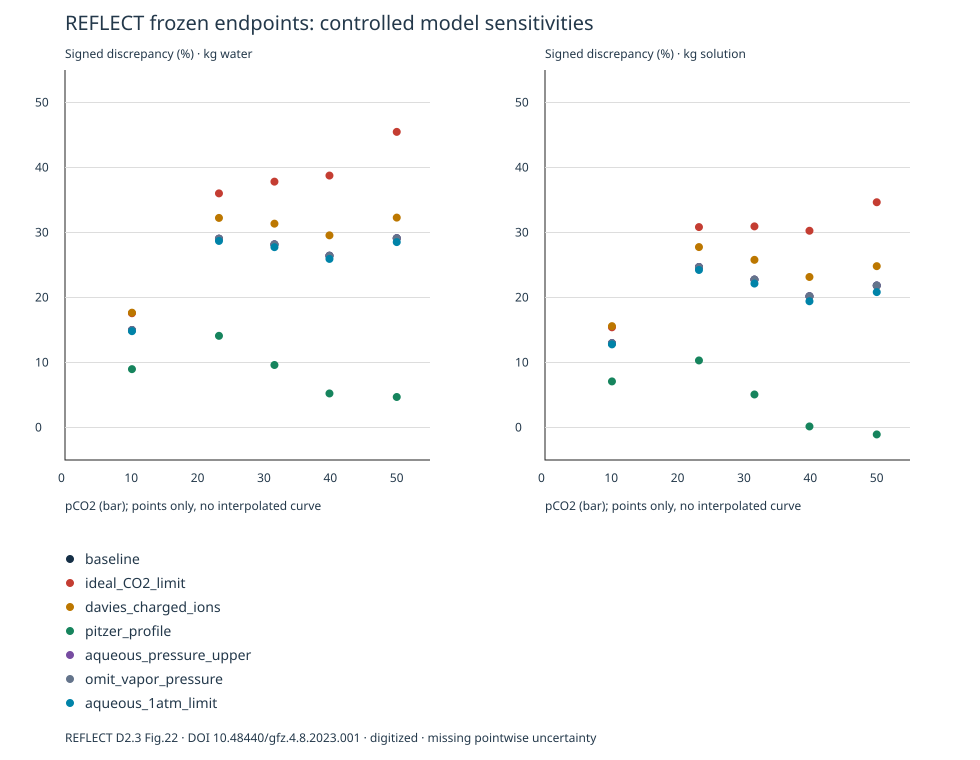

# REFLECT discrepancy investigation — v0.8.0

**Conclusion: experimentally challenged; systematic discrepancy unresolved.** This is scientific model validation and applicability management, not new chemistry or model fitting. All five frozen observations and the v0.7.0 baseline remain unchanged. The v0.7.1 seven-choice results are preserved; v0.8.0 adds auditable thermodynamic/species/pressure metadata, observable contracts, descriptive errors and evidence-scoped profiles.

## Data and source audit

[Machine-readable metadata audit](REFLECT_METADATA_AUDIT_V080.json) and [field-by-field source locations](REFLECT_METADATA_AUDIT_V080.md) distinguish reported, measured, derived and unknown facts. Original PDF pp.22–23 supports regulated pCO2 and defines it as autoclave absolute pressure minus vapor pressure; 24 °C and the five markers come from Fig.22 p.26. The kg denominator, pointwise raw analytical uncertainty, exact loadings and dilution worksheets remain UNKNOWN. EDTA at pH 10 is an analytical procedure, not endpoint-pH data.

## Gas and pressure semantics

The current endpoint uses `log10(pCO2_bar / 1.01325)` in EQUILIBRIUM_PHASES, not log fugacity. PHREEQC applies its native PR correction when the selected CO2 critical properties exist. Solute-free water initialization `pH 7 charge` is explicit and never changes measured ion totals. The externally regulated reservoir is modeled with nonexhausted numerical moles, not a measured headspace. Aqueous pressure is approximately pCO2+0.03 bar, separately instrumented as PRESSURE. Calcite must remain and attain SI≈0.

Fixed partial pressure, fixed-total-pressure gas and finite fixed volume are different physical models. Missing operational headspace/valve history prevents a uniquely determined finite-gas REFLECT alternative. No guessed volume, ideal-gas inventory or boundary is added to reduce the residuals. Example 7 benchmarks the distinction independently of this experiment.

Baseline φ is approximately 0.945–0.739 across the five points. Actual aqueous CO2/free Ca activities, pressure-adjusted log K, Ca/DIC, SI and database-specific GFW/masses are in the deterministic output. Structural EOS availability and observed numerical φ are separate audits.

## Quantitative metrics

Metrics below are unweighted CaCO3-equivalent g/kg; the last column is percent. Mean signed error is not mean relative error. No confidence interval, sigma, p-value, acceptance score or preferred model is inferred. Both ambiguous kg bases remain visible.

| Declared choice | kg basis | Mean signed error | MAE | RMSE | Max absolute relative % |
| --- | --- | ---: | ---: | ---: | ---: |
| `baseline` | water | 0.644010 | 0.644010 | 0.671513 | 29.115 |
| `baseline` | solution | 0.512940 | 0.512940 | 0.530898 | 24.681 |
| `ideal_CO2_limit` | water | 0.896541 | 0.896541 | 0.953850 | 45.480 |
| `ideal_CO2_limit` | solution | 0.720889 | 0.720889 | 0.758669 | 34.655 |
| `davies_charged_ions` | water | 0.720349 | 0.720349 | 0.748772 | 32.292 |
| `davies_charged_ions` | solution | 0.585716 | 0.585716 | 0.604405 | 27.759 |
| `pitzer_profile` | water | 0.202316 | 0.202316 | 0.214049 | 14.102 |
| `pitzer_profile` | solution | 0.093926 | 0.106211 | 0.134151 | 10.315 |
| `aqueous_pressure_upper` | water | 0.644084 | 0.644084 | 0.671585 | 29.118 |
| `aqueous_pressure_upper` | solution | 0.513043 | 0.513043 | 0.531001 | 24.685 |
| `omit_vapor_pressure` | water | 0.643999 | 0.643999 | 0.671502 | 29.115 |
| `omit_vapor_pressure` | solution | 0.512925 | 0.512925 | 0.530883 | 24.680 |
| `aqueous_1atm_limit` | water | 0.633601 | 0.633601 | 0.660287 | 28.701 |
| `aqueous_1atm_limit` | solution | 0.497140 | 0.497140 | 0.513856 | 24.234 |

The signed absolute/relative errors for every point and both prediction changes are in [CSV](v080/comparison.csv) and [structured calculations](v080/analysis.json). The report does not rank or optimize choices.



## What the controls establish

- Merely switching the kg denominator does not eliminate the baseline positive bias at any of the five points.
- Removing CO2 nonideality increases predictions about 2.3–12.7%; current baseline already includes PR. This rejects the explanation that the existing baseline simply forgot PR; it does not independently validate PR or other EOS.
- At fixed pCO2, an extra 0.2 bar aqueous pressure changes predictions less than 0.004%. Omitting the approximate 0.03 bar vapor term changes less than 0.001%. Even deliberately nonphysical 1-atm aqueous decoupling changes under 0.5%. Those limited sensitivity results do not justify changing the experimental boundary.
- Same-constant charged-ion Davies comparison increases predictions about 2.3–2.5%. It is a controlled dilute-ion activity choice, not a rejection of all activity models.
- The inherited Pitzer whole-profile comparison reduces predictions about 5.2–18.9%. This is explicitly exploratory: species sets, ion-pair conventions, interaction parameters, constants and volumes change together. In particular, explicit CaHCO3+ and neutral CaCO3 are not represented identically; the audit exposes this. It is not an isolated activity-model effect, independently supported replacement or optimal model selection.

The meaningful justified same-database alternative is the declared charged-ion activity change. Ideal gas and 1-atm liquid-pressure cases are limiting diagnostics only. Pitzer remains a disclosed legacy cross-profile control, not an accepted reconstruction. No blindly substituted SIT/LLNL model or thermodynamic parameter fit is introduced.

Actual database masses are **GFW(CaCO3)=100.0911 g/mol and GFW(Ca)=40.08 g/mol in both baseline and Pitzer runs**. Thus formula-weight differences do not explain the current cross-profile change. These values are read from the exact database in every run, not conventional rounded masses or fit parameters.

## Database review

The production SHA-256 stays `59373961d648dfbf68a40744060c1d64f57ecbec98f4f5fb89f3a1b4213ccd10` (official 3.8.6-17100 phreeqc.dat). It is an ion-association profile with species-specific gamma parameters and defaults. Calcite/CO2 and required aqueous components, analytic/enthalpy coefficients, molar volumes and gas critical properties are audited. Critical CO2 values are T_c=304.2 K, P_c=72.86 atm, acentric factor 0.225.

The presence of coefficients does not establish their empirical T/P range or internal consistency. Neutral CO2/high-pressure interaction treatment, species completeness and database calibration lineage require independent review. The review by Lu et al., DOI 10.1016/j.earscirev.2021.103888, and USGS Program Limitations reinforce that different species/activity conventions are not interchangeable. No global validity range is assigned based on a successful execution.

## Four separate conclusions

1. Engine/reference agreement: official version-matched Examples 6/7/22, direct adapter replay and locked references assess implementation. They are not experimental evidence.
2. Chemical accounting: all 35 controlled endpoints check Ca/C/H/O including remaining calcite and numerical gas inventory, net charge and nonexhausted equilibrium boundaries. These are numerical checks.
3. Empirical accuracy: baseline total-Ca equivalent predictions remain systematically high, with missing pointwise uncertainty and an unresolved denominator. No endpoint is dropped or recalibrated.
4. Mechanism interpretation: profile annotation leaves the original 210-candidate chemistry/proxy classes and actual formation-order uncertainty intact. Fixed-model threshold/discretization robustness is distinct from independent experimental accuracy.

## Evidence still needed

Obtain raw pointwise EDTA/standardization/dilution/recovery records and define the kg denominator, loading and valve/pressure history. Independently measure Ca plus CO2 or total inorganic carbon under controlled low-temperature high-pCO2 conditions, with uncertainties and approach to equilibrium from both sides. These observations can discriminate gas dissolution versus aqueous speciation; a second fitted thermodynamic curve cannot. A second held-out experimental comparison remains incomplete; candidate literature screening from v0.7.1 is retained.

## Review and reproduction

[Scientific workflow and profile API](../../docs/SCIENTIFIC_VALIDATION.md) · [evidence registry](../models/evidence.toml) · [model profiles](../models/profiles.toml) · [official benchmarks](UPSTREAM_BENCHMARKS_V080.md).

```sh
julia --project=. scripts/validate_scientific_models.jl results
julia --project=. scripts/validate_upstream.jl results
# in the scientific exported folder:
PHREEQC_EXECUTABLE=/absolute/path/to/phreeqc julia --project=. reproduce.jl
```

A standalone HTML report contains real calculated comparisons, signed errors, model/database identity, boundary/species audits, matching scopes, unknowns and reproduction instructions. Full source/protocol/profile/database and raw engine artifacts are retained. No remote release or scientific certification is implied.
