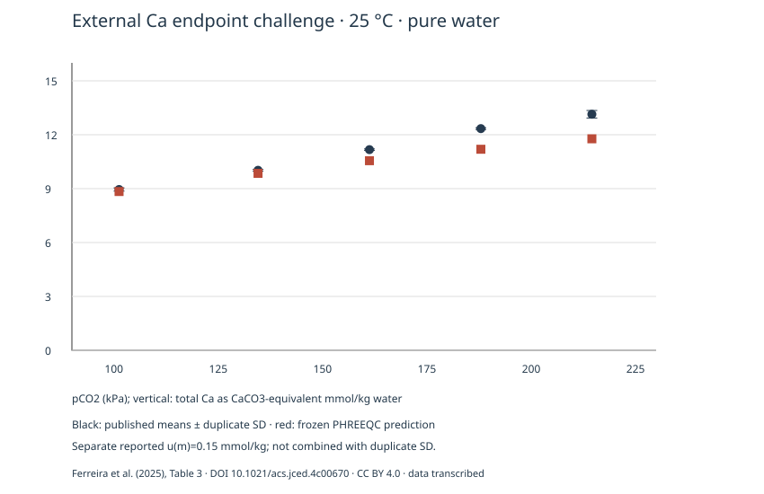

# v0.8.1 — Independent-source experiment; strict holdout qualification pending

**Outcome: a second independent-source prediction comparison is completed; database-calibration holdout independence remains UNKNOWN.** No model constants, concentrations or REFLECT observations were tuned. No profile receives experimental support or strict-path qualification.

## Main result

All five published 25 °C pure-water means from Ferreira et al. (2025), [DOI 10.1021/acs.jced.4c00670](https://doi.org/10.1021/acs.jced.4c00670), were frozen before the first model prediction. The unchanged baseline model predicts lower values at all five points.

| pCO2 kPa | Observed Ca equivalent mmol/kg water | Duplicate SD | Prediction | Signed error mmol/kg | Relative error % |
| ---: | ---: | ---: | ---: | ---: | ---: |
| 101.3 | 8.95 | 0.09 | 8.838459 | -0.111541 | -1.246 |
| 134.6 | 10.02 | 0.05 | 9.849499 | -0.170501 | -1.702 |
| 161.3 | 11.17 | 0.04 | 10.554388 | -0.615612 | -5.511 |
| 188.0 | 12.34 | 0.05 | 11.191264 | -1.148736 | -9.309 |
| 214.6 | 13.14 | 0.21 | 11.772928 | -1.367072 | -10.404 |

Mean signed error: **-0.682692 mmol/kg**; MAE **0.682692 mmol/kg**; RMSE **0.849584 mmol/kg**; maximum absolute relative error **10.404%**. Descriptive metrics, not a validation score. The frozen protocol abbreviation MSE refers to mean signed error here; no mean-squared-error acceptance criterion is used.



## What this says about REFLECT

REFLECT has five positive baseline discrepancies at 24 °C and about 10–50 bar pCO2. This independent research group has five negative central discrepancies at 25 °C and 1.013–2.146 bar pCO2. Thus **the same positive-bias direction is not reproduced in this different domain**. This does not show that REFLECT is wrong, validate the model generally, or identify pressure as the cause. Temperature, pressure domain, boundary implementation, source family, analytical method and operational sample definition change together. No universal correction factor, pooled RMSE, parameter fit or significance claim is made.

The first two differences are relatively small; the higher-pressure points in this new series differ more strongly. Reported standard estimated u(m)=0.15 mmol/kg, u(P)=2.7 kPa and u(T)=0.05 K remain separate from duplicate SD, n=2. The first point's absolute residual is smaller than u(m); this alone is not statistical model validation. No covariance model is known, and duplicate SD and u(m) must not be added blindly or substituted for one another.

## Frozen model and actual controls

- Production database unchanged: SHA-256 `59373961d648dfbf68a40744060c1d64f57ecbec98f4f5fb89f3a1b4213ccd10`. Same CaCO3 endpoint model, ion association and native PR; no author-fitted Pitzer or OLI parameters imported.
- Selected only all five Table 3 points at 298.15 K; the 278.15/288.15 K rows fall below the existing API lower temperature limit and MEG cases are outside scope. Selection was not based on residuals.
- Source molality is mmol CaCO3-equivalent/kg water, interpreted from AAS Ca. Prediction is 1000×TOT(Ca), using actual final solvent mass, not free Ca2+ or initial kg. CaCO3:Ca molar ratio is 1:1.
- 1 kg model water, 10 g calcite and 10 mol numerical CO2 reservoir normalize an excess-solid endpoint. They are not recovered measured per-run loadings. The existing API recipe enum mentions degassed water; it denotes an initially solute-free model here, not a claim that this source reported degassing. Initial trace chemistry/DIC is not reconstructed.
- Aqueous total pressure=pCO2+0.0317 bar is a declared water-vapor approximation, with a control omitting the term. Actual engine PRESSURE is independently checked.
- Eight frozen choices per point: primary, upper solid stock, upper gas buffer, pressure ±2.7 kPa, temperature ±0.05 K, omitted vapor contribution. All **40 actual endpoints** pass Ca/C/H/O, net charge, saturation and remaining-stock/reservoir checks. Extra telemetry replays agree with the endpoint API.
- Solid/gas stock controls change predicted molality less than 1e-8 mmol/kg. Pressure/temperature controls are individual stresses, not a joint confidence envelope. No fitted environmental sequence or pH overwrite is introduced.

## Why strict holdout qualification remains pending

[Source audit](../holdout-ferreira-2025/SOURCE_AUDIT.md) distinguishes independent laboratory source from database calibration independence. Related data occur in a 2022 thesis; original data and pressure coordinates are not identical to the 2025 table and are not silently reconciled. The two documents are one related data family, not two experimental replications.

[Official source-history comparison](../lineage-v081/block-comparison.json) shows some relevant aqueous coefficients changed between the 2021 snapshot and the May-2024 production file. No explicit citation of this UFRN data was found, but absence of citation is not evidence of nonuse. Full parameter lineage remains UNKNOWN. Source independence from REFLECT and no MineralTrace fitting are established; a completely out-of-calibration holdout is not certified.

The primary paper was recovered as a [publisher-text retrieval transcript](../../sources/FERREIRA-2025-PUBLISHER-TRANSCRIPT.txt), with all five values and Table 3 uncertainty footnotes checked. Its hash is explicitly a transcript hash, not an original PDF hash; direct publisher PDF download returned 403. The 2022 thesis original PDF was obtained and verified through the university public repository, retained locally for source review, with public identity/hashes tracked.

No measured DIC/dissolved CO2 or independent endpoint pH is available in the selected subset. The authors' pressure–pH correlation is derived, so it is excluded from validation. Glass-cell filtration cutoff is not specified: analyzed settled, acidified aliquot Ca is treated as reported solubility, while fine-solid carryover is an untested possibility, not an asserted error. Exact operating gas history, loadings and raw analytical worksheets remain incomplete.

## Registry and reproduction

The second source is registered separately with `independent_of_calibration = "UNKNOWN"`, `experimentally_challenged`, exact five joint conditions and no supported path observable. Neither current profile nor strict mode is promoted. Historical v0.7/v0.8 results remain unchanged.

[Pre-prediction receipt](../holdout-ferreira-2025/FREEZE.toml) locks observations, protocol, source audit, publisher transcript, script, code, package version, database and engine hashes. The runner refuses silent changes. [Independent reproduction audit](REPRODUCTION_AUDIT.json) confirms byte-identical analysis, CSV and SVG under the exported code/data/database.

```sh
julia --project=. scripts/validate_holdout.jl results
# in the exported folder:
PHREEQC_EXECUTABLE=/absolute/path/to/phreeqc julia --project=. reproduce.jl
```

Keep the full export for raw PHREEQC inputs/outputs/dumps, chemical accounting, exact engine settings, code/protocol/database/source snapshots. The standalone HTML report is local, not a hosted demonstration or remote release.

## Next scientifically justified step

Obtain raw matched-condition data near 24–25 °C spanning both low and 10–50 bar pCO2, with Ca plus independently measured CO2/DIC, sample filtration/dilution/recovery records, pointwise uncertainties and parameter-source provenance. Establish calibration independence before promoting a strict holdout. Do not fit a correction from these two unmatched series or broaden mechanisms/minerals/UI.
