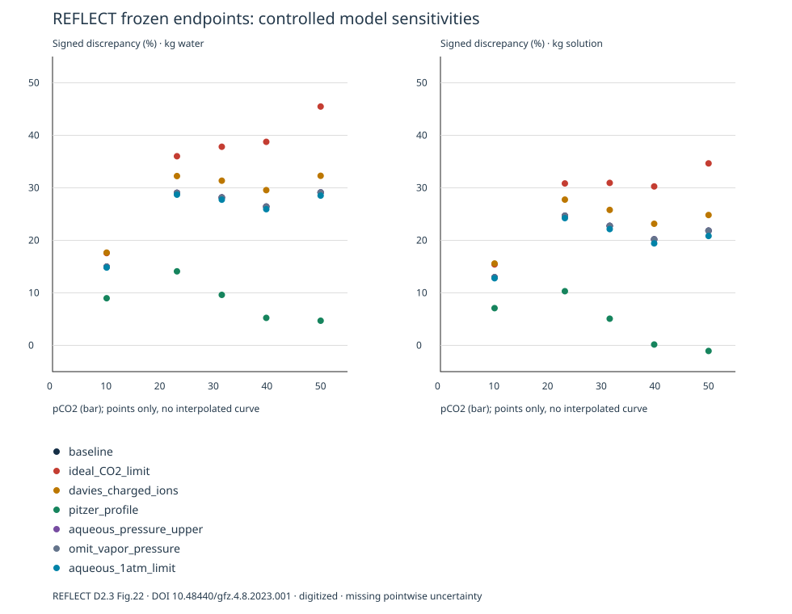

# REFLECT 五点偏差归因 — v0.7.1

日期：2026-11-04。**状态：Challenged / discrepancy unresolved。** 本次完成七种受控选择 × 五个冻结观测点，不拟合任何参数、不新增发现机制、不改变 v0.7.0 实测点或误差记录。

## 主要结果

| 模型选择 | 预测相对基准变化：kg 水 | 实测偏差：kg 水 | 实测偏差：kg 最终溶液 |
| --- | ---: | ---: | ---: |
| `baseline` | +0.000% 至 +0.000% | +14.982% 至 +29.115% | +12.968% 至 +24.681% |
| `ideal_CO2_limit` | +2.259% 至 +12.675% | +17.579% 至 +45.480% | +15.415% 至 +34.655% |
| `davies_charged_ions` | +2.331% 至 +2.490% | +17.663% 至 +32.292% | +15.592% 至 +27.759% |
| `pitzer_profile` | -18.914% 至 -5.222% | +4.694% 至 +14.102% | -1.067% 至 +10.315% |
| `aqueous_pressure_upper` | +0.002% 至 +0.003% | +14.986% 至 +29.118% | +12.972% 至 +24.685% |
| `omit_vapor_pressure` | -0.000% 至 -0.000% | +14.982% 至 +29.115% | +12.967% 至 +24.680% |
| `aqueous_1atm_limit` | -0.458% 至 -0.142% | +14.819% 至 +28.701% | +12.787% 至 +24.234% |

范围是五个离散点的最小／最大值，不是置信区间。误差为 `(Cpred − Cobs)/Cobs`；完整逐点值、另一质量基准下的预测变化和遥测见 [CSV](comparison.csv)、[确定性数据](analysis.json)。



## 已排除或缩小的解释

- **仅改质量分母不足以消除基准高估。** 两种分母下原五点均为正；分母定义仍未从原文消歧。
- **基准并未遗漏原生 PR 修正。** 五点推导的 φ 为 0.9451 至 0.7386；改为理想气体使预测上升 2.259%–12.675%，因此“补上缺失非理想气体修正”不能解释当前基准偏差。尚未独立检验 PR 本身的准确性或其他 EOS。
- **本范围的小幅溶液压力处理不足以解释 13%–29%。** 保持气体 pCO₂ 不变，总液相压力 +0.2 bar 的预测变化仅 +0.002%–+0.003%；省略约 0.03 bar 蒸气压项小于 0.001%。即使不物理地解耦为液相 1 atm，变化也仅 −0.142% 至 −0.458%；这一极限绝不可作为替代实验边界。
- **Davies 替换所列带电物种参数未改善此组数据。** 同常数、同中性物种处理下，预测反增约 2.3%–2.5%。这只约束此项受控改变，不能排除所有活度处理。
- v0.7.0 的固相 10–40 g、数值气库 10–20 mol、温压小扰动记录继续保留；未耗尽数值库存的稳态不敏感，不等于真实实验运行历史已重建。

## 仍然可能的解释

**整套 Pitzer 配置明显影响结果**：预测下降约 5%–19%，但五点水基准仍全部偏高，最终溶液基准下有一点略偏低。这个近似改善不是“Pitzer 已验证”的证据。物种集合、Ca–碳酸根配合、热力学常数、相互作用参数、体积参数及微小式量差异一同变化；不能归因于其中单项，也没有从这些点选择最小误差组合。

Pitzer 作为有来源的对照不是无条件推荐：此处离子强度约 0.061–0.119 mol/kgw（全部对照），且高压溶解 CO₂ 与特定离子相互作用的经验准确性尚未独立核查。各配置的实际离子强度、γCa、γHCO₃、压力修正后 log K 及数据库摘要均已输出，便于后续进行有依据的组分分解。

实验端的 g/kg 分母、逐点稀释换算、温压条件共享运行的历史、具体装载量和误差传播仍缺失。原文有合理的操作平衡判据，但没有逐点正反向逼近平衡的证据；不能凭偏差就断言未达平衡、采样析出或热力学常数有误。

## 三条质量路线分别评价

1. **引擎一致性**：带额外压力遥测的基准与原 `calcite_endpoint` API 一致，溶液实际压力被逐点断言。另进行原始 deck 的直接 CLI 重放与导出包独立复现。
2. **化学记账**：35 个对照逐一检查 Ca/C/H/O（包括剩余矿物和数值 CO₂ 库）、电荷、固相未耗尽、气库未耗尽及 Calcite SI≈0。守恒闭合不等于实验正确。
3. **经验准确性**：记录全部有符号偏差，不以最小误差排序、不把软件测试当实验验收。固定模型下的阈值／离散化稳健性不能认证模型准确度。

## 下一步可区分假说的证据

- 获取原始五点分析表：g/kg 分母、原始 EDTA 滴定量、空白/标准化、采样及稀释质量、每点重复值与误差、实际 P/T 和对应装载量。
- 独立测量同温压下的溶解 CO₂ 或总无机碳，联合总 Ca；可区分气体溶解/逸度与离子配合效应。pH 需高压条件下可追溯测量，不能用当前预测值充当观测。
- 同一温度上改变 pCO₂、充分说明纯水组成，从欠饱和与过饱和两侧接近平衡，记录重复终点；同时检查过滤和减压采样回收。
- 获取第二套低温高 pCO₂ 独立数据并审查其是否曾参与数据库参数估计，再冻结测试协议。现已登记候选文献，但没有声称完成第二组 holdout 比较。

## 执行检查

完整真实引擎回归 **1685 项通过**（新增诊断变换／边界检查 10 项）。35 个受控端点均通过元素、电荷及边界检查。导出包在自身代码／数据库快照下重算，`analysis.json`、`comparison.csv`、`comparison.svg` 逐字节一致；Pitzer 原始 deck 的直接 CLI 重放亦得到逐字节一致的 `selected.tsv`。这些是工程与化学一致性证据，不把经验偏差转成通过。见[检查清单](VERIFICATION.json)、[完整输出](test-output.txt)。

## 复核入口

- [原文计量与实验定义审计、第二数据筛查](SOURCE_AUDIT.md)
- [受控选择、适用性与判据协议](PROTOCOL.md)
- [模型适用性登记](MODEL_APPLICABILITY.toml)
- [归因脚本](../../../scripts/attribute_calcite_bias.jl)、[数据变换检查](../../../test/v071_attribution.jl)
- 原始运行目录（本地忽略归档）：`results/calcite-attribution-KP4dqg/`，包含离线 `report.html`、所有 PHREEQC 输入/输出/状态/清单、数据库/代码/原始资料快照及 `reproduce.jl`。运行路径是本地归档，不是已托管的公开演示。

```sh
julia --project=. scripts/attribute_calcite_bias.jl results
# 需要已配置 PHREEQC_EXECUTABLE、冻结 PHREEQC_DATABASE；pitzer.dat 默认取同目录。
# 在导出目录内：
PHREEQC_EXECUTABLE=/absolute/path/to/phreeqc julia --project=. reproduce.jl
```

[快照数据库和来源摘要](databases/README.md)来自官方 PHREEQC 3.8.6-17100 的 `database/`；`databases/ideal-co2.dat` 与 `davies-ions.dat` 是明确标注的诊断派生文件。不得在常规发现中默默替换数据库。原始和派生摘要均在 analysis.json；数据库与原始实验来源的条款独立于项目 MIT 代码许可。

历史 Example 1：**Root cause identified: database/speciation version dependence.** 沿用 v0.7.0 的同二进制与历史数据库归因；原三项历史差异仍保留，不再列为原因不明的适配器故障。
